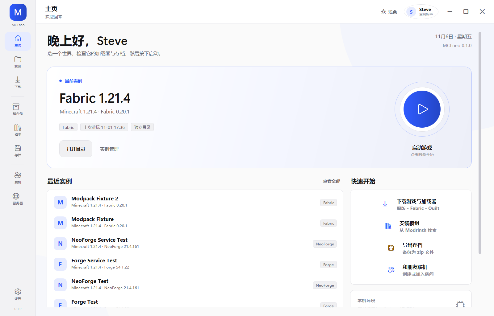

# MCLneo

MCLneo 是一个面向 Windows 的 Minecraft 启动器，用来管理游戏、版本、模组、整合包、存档和联机房间。

当前版本：**0.1.3**

## 功能

| 功能 | 说明 |
| --- | --- |
| 多游戏 | 新建、切换、重命名、删除游戏；每个游戏可以有自己的模组、存档和配置 |
| 游戏安装 | 安装原版游戏和运行库，支持 Mojang 官方源与 BMCLAPI 镜像 |
| 加载器 | 安装 Fabric、Quilt、Forge、NeoForge |
| 整合包 | 搜索并安装 Modrinth 整合包，也可以导入本地 `.mrpack` 文件 |
| 模组 | 搜索 Modrinth 模组，按游戏版本和加载器筛选，自动安装必选依赖，支持启用/禁用/删除 |
| 资源 | 安装资源包和光影到当前游戏 |
| 存档 | 查看存档、备份为 zip、导入存档、打开数据包目录 |
| 服务器 | 管理服务器列表，保存后可以直接启动并连接 |
| 联机房间 | 使用 EasyTier 创建或加入房间；双方有公网 IPv6 时也可以直接连接 |
| Java | 自动扫描 Java，下载和管理 Adoptium 运行时，修复游戏 |
| 日志与修复 | 查看游戏日志，分析常见崩溃特征，检查并修复游戏文件 |
| 账户 | 离线账户，以及 authlib-injector / Yggdrasil 第三方账户 |
| 外观 | 浅色/深色主题、多种强调色、圆角窗口和界面过渡动画 |
| 更新 | 支持从更新清单检查并安装新版本 |

## 安装

从发布页下载 `MCLneo-0.1.3-Setup.exe`，运行安装即可。默认安装到 `D:\MCLneo\Launcher`。

## 快速开始

1. 启动 MCLneo，在右上角账户菜单中设置玩家名，或登录第三方账户。
2. 打开“设置”，确认游戏目录、Java 和内存分配。
3. 在“游戏”页新建游戏，或到“下载”页安装游戏版本和加载器。
4. 回到主页，选择游戏，点击启动圆盘开始游戏。

## 账户

- **离线账户**：只需要玩家名，适合单人游戏和不验证正版的服务器。
- **第三方账户**：支持 authlib-injector / Yggdrasil 服务（例如 LittleSkin）。密码不会保存，登录令牌保存在本机。
- **微软账户**：当前版本不提供微软正版登录，依赖正版验证的服务器暂时无法加入。

## 联机房间

1. 在单人游戏中按 `Esc`，选择“对局域网开放”，记下聊天栏显示的端口。
2. 在 MCLneo 的“联机房间”页输入端口并创建房间。
3. 把 `MCLN1:` 开头的邀请码发给朋友。
4. 朋友加入后，在 Minecraft 的“多人游戏 → 直接连接”中连接房间页显示的 `127.0.0.1:<端口>`。

EasyTier 需要创建 TUN 虚拟网卡，因此创建或加入房间时需要以管理员身份运行 MCLneo。未提权时，联机页面会提供“以管理员身份重启”。

## IPv6 直连

双方都有公网 IPv6 时，可以不使用 EasyTier：

1. 房主在单人游戏中“对局域网开放”，把端口填到“我是房主”，创建 IPv6 直连。
2. 房主把生成的 `[IPv6]:端口` 地址发给朋友。
3. 朋友在“我是成员”中填入地址并加入。
4. 朋友在 Minecraft 中连接启动器显示的 `127.0.0.1:端口`。

房主需要允许 Windows 防火墙和路由器防火墙放行对应 TCP 端口。网络没有公网 IPv6 时请使用 EasyTier。

## 数据目录

| 内容 | 默认位置 |
| --- | --- |
| 启动器配置、日志、缓存、Java 运行时 | `D:\MCLneo\data` |
| 游戏根目录 | `D:\MCLneo\game`（可在设置中修改） |
| 游戏 | `<游戏根目录>\versions\<游戏名>` |
| 游戏配置 | `<游戏目录>\mclneo.instance.json` |
| 存档备份 | `<游戏目录>\backups\worlds` |
| 回收目录 | `D:\MCLneo\data\trash` |
| 导出文件 | `D:\MCLneo\exports` |

MCLneo 使用标准 Minecraft 目录结构。把游戏目录指向已有的 `.minecraft` 后，启动器会扫描并显示其中的版本，可以直接导入使用。

## 系统要求

- Windows 10 1809 或更高版本 / Windows 11，64 位
- 安装游戏和下载资源需要网络连接
- 联机房间需要管理员权限和 EasyTier 运行环境

## 注意事项

- 删除游戏或存档时默认移动到回收目录，不会立即永久删除。
- 游戏、模组和整合包属于外部内容，请确认来源和许可。
- MCLneo 不附带 Minecraft 游戏文件或 Mojang 资源。
- Minecraft 是 Mojang Studios 的商标，本项目与 Mojang Studios、Microsoft 没有隶属或背书关系。
